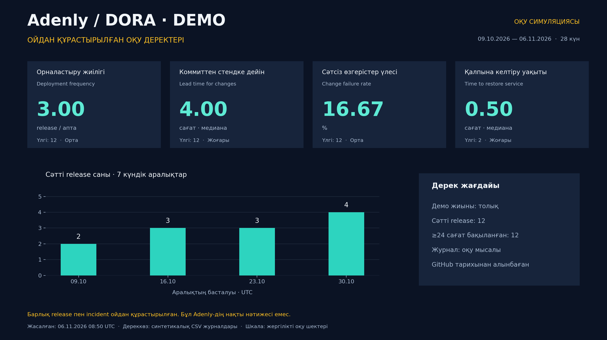

# Adenly
Adenly IT Project - Team Project

## DORA дашборды

[**Сандармен толтырылған оқу дашбордын ашу →**](docs/delivery/simulation/README.md)

**ОЙДАН ҚҰРАСТЫРЫЛҒАН ОҚУ ДЕРЕКТЕРІ:** 3 release/апта · lead time 4 сағат · CFR 16,67% · recovery 30 минут. Бұл нақты GitHub нәтижесі емес.

[Нақты GitHub деректері бойынша бөлек есеп](docs/delivery/report/README.md). Жаңа нақты өлшем үшін [DORA dashboard](https://github.com/Arnurzhairbek/Adenly/actions/workflows/dora.yml) → **Run workflow → main**; нәтиже прогонның **Summary** бөлімінде көрінеді. Симуляцияны қайта есептеу: `python scripts/dora_simulation.py`.

## Базалық апталық жоспар

[15 апталық қарапайым кесте — Word жүктеу](https://github.com/Arnurzhairbek/Adenly/raw/refs/heads/main/docs/requirements/Adenly_Aptalyk_zhospar.docx). Қазір 10-апта. [Браузерде оқу](docs/requirements/basic_weekly_plan.md).

## Техникалық тапсырма — ТЗ

[Adenly ТЗ, қазақша](docs/requirements/README.md): өнім талаптары мен қабылдау критерийлері. Базалық апталық жоспар жоғарыда жеке Word файлымен берілген.

## Нақты жұмыс backlog-ы

[Басым тапсырмалар, түзетілген код, қабылдау шектеулері және live Projects іске қосу шарты](docs/plan/real-backlog.md). Оқу симуляциясынан бөлек жүргізіледі.

## ЛЗ 8 және Рубеждік бақылау 1

[Қазақша есептер, формулалы бюджет, SLO/SLA, орналастыру салыстыруы және 1–8 апта артефактілері](docs/lz8/README.md). Word, PDF, Excel және толық ZIP пакетін GitHub арқылы жүктеуге болады.

## ЛЗ 9 — екі спринт симуляциясы

[Қазақша оқу симуляциясы: тақта саясаты, WIP, DoR/DoD, екі спринт метрикалары, CFD және бір әрекетті ретроспектива](docs/lz9/README.md). CSV, Python, Word, PDF, Excel және ZIP пакет қоса берілген. Live GitHub Projects API қолжетімділігі шектеулі екені құжатта көрсетілген.

[Нақты GitHub Issues экспорты — CSV/JSON және Projects қолжетімділігі](docs/lz9/data/live/README.md).

## ЛЗ 10 — CI/CD және DORA

[Пайплайн, coverage, нақты DORA дашборды, релиз/откат чек-листтері және қалған сыртқы шарттар](docs/delivery/README.md).
