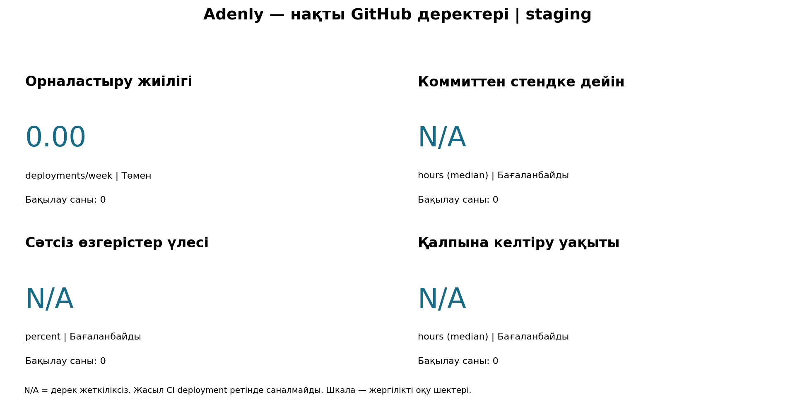

# Adenly — DORA дашборды

Жиналған уақыт: 2026-11-06T05:51:29.316113+00:00. Орта: **staging**.

Терезе: 2026-10-09T05:51:27.671341+00:00 → 2026-11-06T05:51:27.671341+00:00.

| Метрика | Мән | Бірлік | Оқу шкаласындағы деңгей | Бақылау саны |
|---|---:|---|---|---:|
| Орналастыру жиілігі | 0.000 | deployments/week | Төмен | 0 |
| Коммиттен стендке дейін | N/A | hours (median) | Бағаланбайды | 0 |
| Сәтсіз өзгерістер үлесі | N/A | percent | Бағаланбайды | 0 |
| Қалпына келтіру уақыты | N/A | hours (median) | Бағаланбайды | 0 |

Deployments API толық: **True**. Инцидент журналы бекітілген: **False**.

Lead time — әр deployment-тің head commit-інен алғашқы success-ке дейін. CFR тек ≥24 сағат бақылауы толық өзгерістер үшін; журнал белгісіз болса N/A. Recovery — нақты инциденттерден ғана; оқу жаттығуы қосылмайды.

Журналдағы белгілі түзету еңбегі: 0 адам-сағат. Толық шығын: N/A — журнал толықтығы расталмаған.

## CI тарихы (DORA deployment емес)

| Прогон | Нәтиже | Толық elapsed, секунд |
|---|---|---:|
| [42024795594](https://github.com/Arnurzhairbek/Adenly/actions/runs/42024795594) | success | 106.0 |
| [42023961386](https://github.com/Arnurzhairbek/Adenly/actions/runs/42023961386) | success | 102.0 |
| [42022694424](https://github.com/Arnurzhairbek/Adenly/actions/runs/42022694424) | success | 106.0 |
| [41025715248](https://github.com/Arnurzhairbek/Adenly/actions/runs/41025715248) | success | 104.0 |
| [41024239140](https://github.com/Arnurzhairbek/Adenly/actions/runs/41024239140) | success | 121.0 |
| [41023141637](https://github.com/Arnurzhairbek/Adenly/actions/runs/41023141637) | success | 97.0 |
| [39925776637](https://github.com/Arnurzhairbek/Adenly/actions/runs/39925776637) | success | 103.0 |
| [39920922933](https://github.com/Arnurzhairbek/Adenly/actions/runs/39920922933) | success | 103.0 |
| [38876081432](https://github.com/Arnurzhairbek/Adenly/actions/runs/38876081432) | success | 103.0 |
| [38875601892](https://github.com/Arnurzhairbek/Adenly/actions/runs/38875601892) | success | 102.0 |
