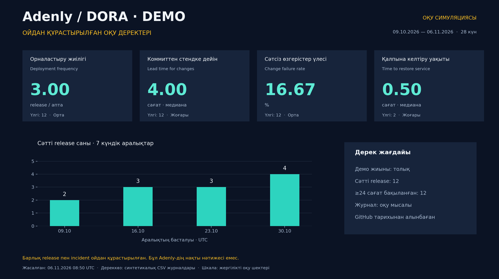

# Adenly — DORA оқу симуляциясы

> **ОЙДАН ҚҰРАСТЫРЫЛҒАН ОҚУ ДЕРЕКТЕРІ.** Барлық release, commit уақыты және incident — есептеуді көрсету үшін жасалған мысал. Бұл Adenly-дің нақты GitHub көрсеткіштері емес.

[Нақты GitHub деректеріне негізделген есепті ашу](../report/README.md)

**Симуляция аралығы:** 2026-10-09T00:00:00Z → 2026-11-06T00:00:00Z · **28 күн / 4 апта**.

**Мысал жасалған уақыт:** 2026-11-06T08:50:47.114464+00:00 (UTC).

| Метрика | Симуляция нәтижесі | Бірлік | Оқу шкаласы | Үлгі саны |
|---|---:|---|---|---:|
| Орналастыру жиілігі · Deployment frequency | **3.00** | release / апта | Орта | 12 |
| Коммиттен стендке дейін · Lead time for changes | **4.00** | сағат · медиана | Жоғары | 12 |
| Сәтсіз өзгерістер үлесі · Change failure rate | **16.67** | % | Орта | 12 |
| Қалпына келтіру уақыты · Time to restore service | **0.50** | сағат · медиана | Жоғары | 2 |

## Сандар қалай алынды?

1. **Жиілік:** 12 feature release / 4 апта = **3 release/апта**. Апталар бойынша: **2 → 3 → 3 → 4**.
2. **Lead time:** реттелген 12 мән — `2, 3, 3, 4, 4, 4, 4, 5, 5, 6, 7, 8` сағат. Медиана = `(4 + 4) / 2` = **4 сағат**.
3. **Сәтсіз өзгерістер үлесі:** 2 release-тен кейін 24 сағат ішінде түзету/rollback қажет болды. `2 / 12 × 100` = **16,67%**.
4. **Қалпына келтіру уақыты:** екі incident ұзақтығы — 40 және 20 минут. Медиана = `(20 + 40) / 2` = **30 минут = 0,50 сағат**.

Барлық release үшін ≥24 сағат бақылау бар деп алынды. Демо incident журналы есеп үшін толық деп қаралады; бұл нақты команданың мониторингін растау емес. Бөлек rollback жазбасы feature release санына және lead time-ға қосылмайды.

## Ойдан құрастырылған екі incident

| ID | Байланысқан release | Басталуы UTC | Қалпына келуі UTC | Уақыт | Тәсіл | Еңбек |
|---|---|---|---|---:|---|---:|
| SIM-INC-01 | SIM-03 | 16.10.2026 10:10 | 16.10.2026 10:50 | 40 мин | hotfix | 1,5 адам-сағат |
| SIM-INC-02 | SIM-09 | 30.10.2026 10:15 | 30.10.2026 10:35 | 20 мин | rollback | 2,0 адам-сағат |

Симуляциядағы жөндеу еңбегі: **3.5 адам-сағат**. Бірнеше адамның еңбегі elapsed recovery уақытынан бөлек есептеледі. Шартты 24 адам-сағат/апта ×4 апта =96 сағат capacity болса, жөндеу үлесі `3,5 / 96 ×100` = **3,65%**. Алдын алу жұмысымен бірге reliability-ге ұсынылатын 20% резерв — бөлек жоспарлық шешім.

## Оқу қорытындысы

Жиілік 3/апта — жергілікті шкалада орта; lead time 4 сағат — жоғары; CFR 16,67% — орта; recovery 30 минут — жоғары. Бұл тек осы синтетикалық жиынның бағасы; нақты команданың деңгейі деп көрсетілмейді.

Мысалдағы келесі жүйелік өзгерістер: релиз алдындағы smoke regression арқылы CFR-ді **≤10%** нысанасына төмендету; автоматты health-check және known-good rollback арқылы recovery-ді **≤15 минутқа** жеткізу. Шартты қайта өлшеу күні: **20.11.2026**. Бұлар өлшенген жетістік емес, оқу мақсаттары.

## Қайта есептеу және бастапқы оқу деректері

- [Синтетикалық deployments.csv](deployments.csv) · [Синтетикалық incidents.csv](incidents.csv).
- [Есептелген metrics.json](metrics.json) · [Нормаланған demo жазбалар](deployments.normalized.json).
- Репозиторий түбірінде: `python scripts/dora_simulation.py`.
- Скрипт GitHub API-ға қосылмайды, deployment/incident жасамайды және нақты есепті өзгертпейді.
