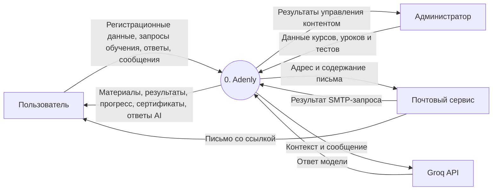
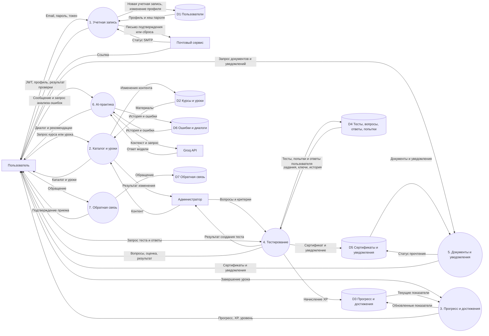
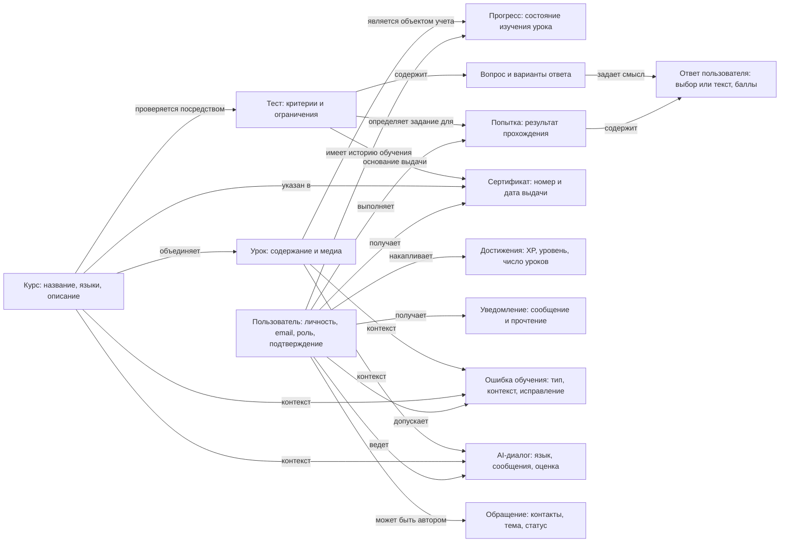
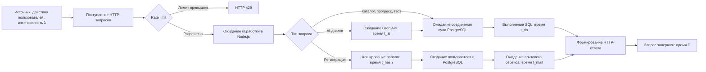
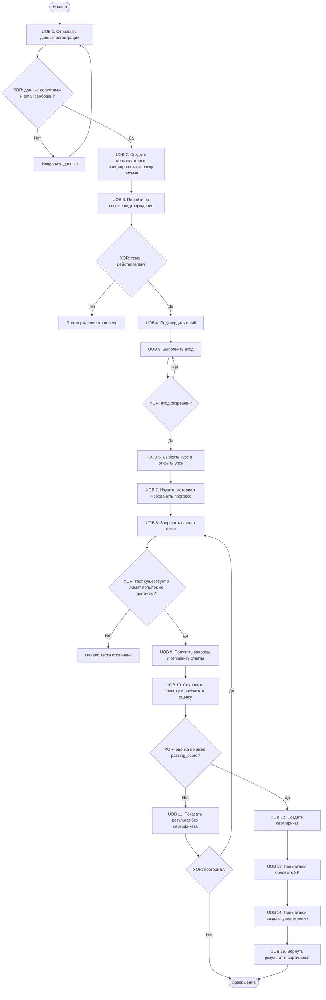
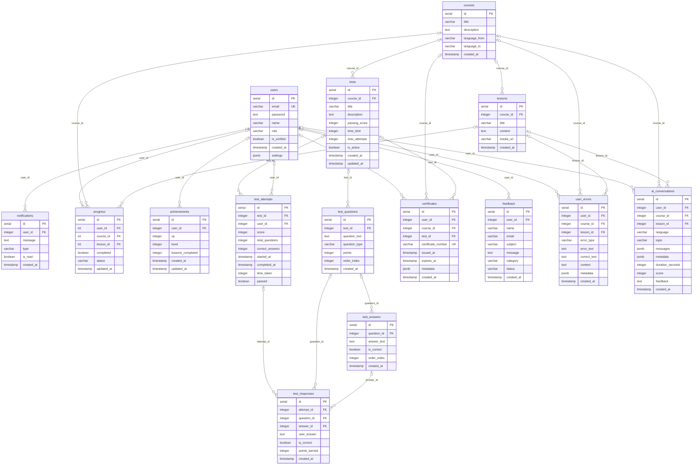

# Диаграммы Adenly

Модели составлены по исходному коду Adenly: `lang-backend/index.js`, `routes/auth.js`, `routes/tests.js`, `db/init.sql`, `db/migration_add_user_errors.sql` и маршрутам API. Это описание структуры и логики, а не подтверждение работы всех сценариев.

DFD и ER представлены в поддерживаемой Mermaid записи. IDEF1, IDEF2 и IDEF3 представлены как содержательные модели с условными обозначениями Mermaid; это адаптация для просмотра, а не строгая графическая нотация стандарта. Для IDEF2 дан проект динамической модели: замеры времени и имитационные эксперименты не выполнялись.

## DFD — контекстный уровень

Прямоугольники — внешние участники; круги — процессы; цилиндры — логические хранилища PostgreSQL. Подписи стрелок обозначают передаваемые данные. Фронтенд и API входят в границу системы Adenly.

## DFD — декомпозиция первого уровня

Прямоугольники — внешние участники; круги — процессы; цилиндры — логические хранилища PostgreSQL. Подписи стрелок обозначают передаваемые данные. Фронтенд и API входят в границу системы Adenly.

## IDEF1 — информационная модель

Модель показывает смысл информации и отношения предметной области, без физических ключей и типов SQL. Подписки/зачисления на курс отдельной сущностью в БД не представлены. Связь сертификата с конкретной попыткой логически возможна, но отдельного внешнего ключа attempt_id в коде нет.

## IDEF2 — динамическая модель обработки запросов

Это качественная схема динамической модели, а не стандартная диаграмма состояний и не выполненная симуляция. Ожидание в Node.js обозначает планирование обработки, а не отдельный реализованный брокер сообщений. Параметры для измерения: λ (запросов/с), t_db, t_hash, t_mail, t_ai, размер пула БД, доли типов запросов и ограничения rate limit. Выходы: время ответа T, пропускная способность, число ожидающих запросов, доля 429 и ошибок. Эксперименты: обычная нагрузка, всплеск запросов, медленная БД, задержка AI. Числовые значения не назначались. Для обычного запроса T приблизительно равно сумме ожидания обработки, ожидания соединения, SQL и формирования ответа; это аналитическое приближение.

## IDEF3 — описание процесса обучения

UOB — единица поведения, стрелки — предшествование, XOR — выбор одного пути. Диаграмма отражает штатный сценарий; полный граф исключений HTTP/SQL не показан. Проверка лимита попыток находится в GET /:testId/start; POST /:testId/submit повторно ее не выполняет. Время time_taken приходит от клиента; started_at и completed_at записываются при отправке ответов. Ошибки начисления XP и создания уведомления перехватываются отдельно и не отменяют успешную выдачу сертификата. Начисление XP использует UPDATE и не создает отсутствующую запись achievements.

## ER — физическая модель PostgreSQL

Показаны все 15 таблиц из init.sql и AI-миграции; settings добавляется при старте API. PK — первичный ключ, FK — внешний ключ, UK — уникальное поле. У каждого родителя может быть 0..N дочерних записей. Все объявленные FK допускают NULL, поэтому на стороне родителя указано 0..1; обязательность связей на уровне интерфейса может быть строже. Дополнительные составные UNIQUE: progress(user_id, lesson_id) и test_attempts(test_id, user_id, started_at). achievements.user_id не имеет UNIQUE: физическая схема допускает несколько записей достижений на пользователя. Для компактности длины VARCHAR, значения по умолчанию и правила удаления здесь опущены; точные ограничения находятся в SQL.

