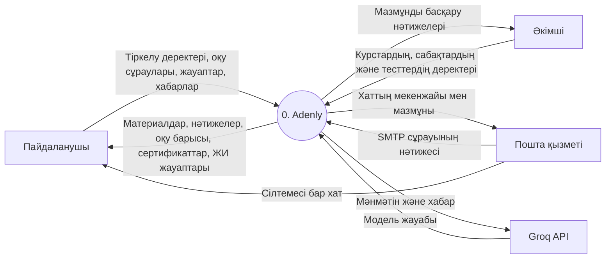
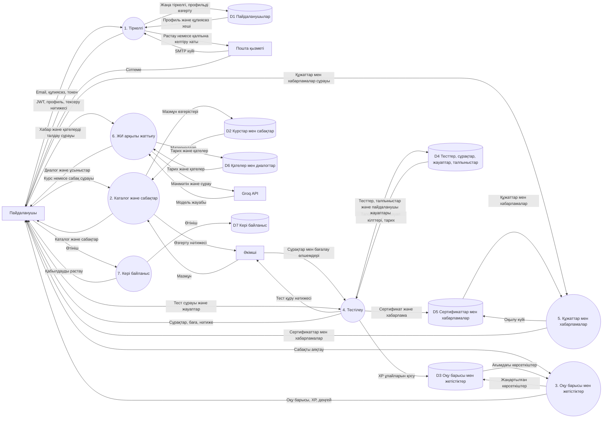
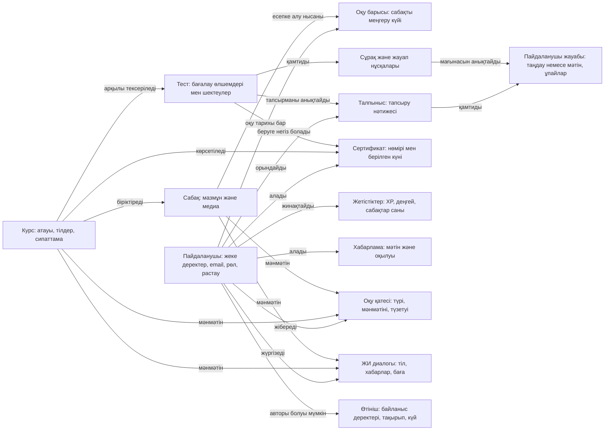
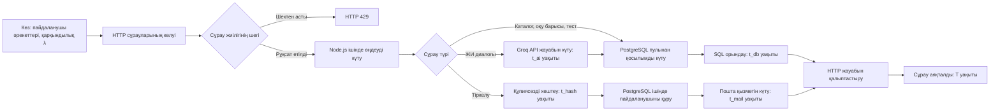
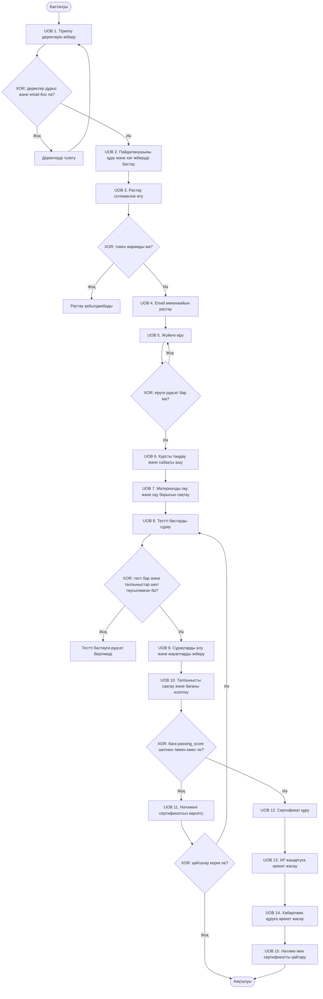
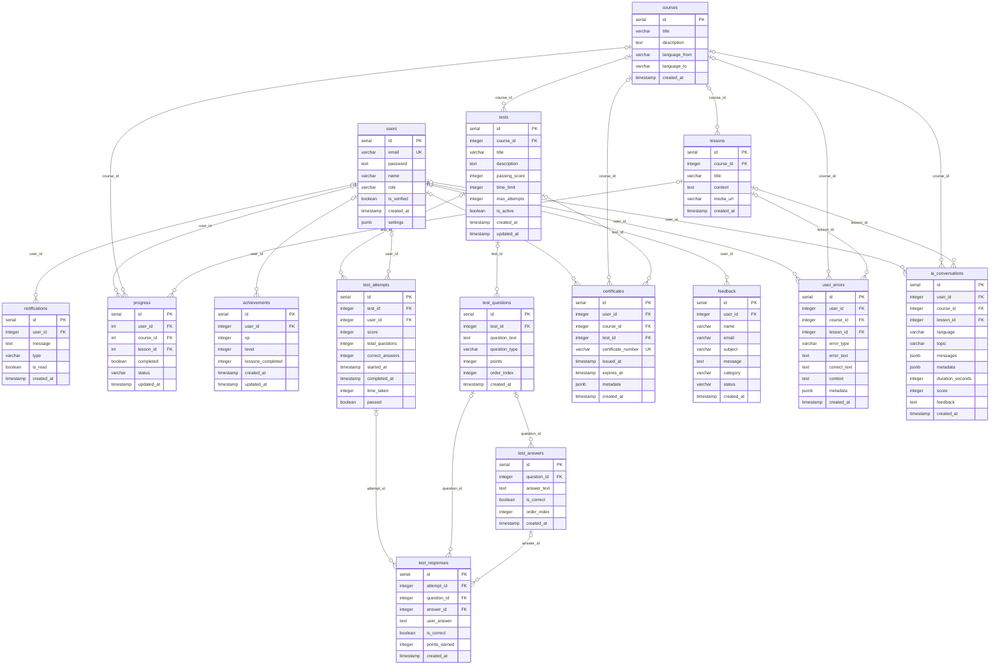

# Adenly диаграммалары

[Орысша нұсқа](../Adenly-diagrams.md)

Модельдер Adenly бастапқы коды мен SQL схемасына негізделген. DFD және ER Mermaid арқылы берілген. IDEF1, IDEF2 және IDEF3 — Mermaid графикасына бейімделген мазмұндық модельдер; қатаң стандарттық графикалық нотация емес. IDEF2 үшін уақыт өлшемдері жүргізілмеген.

## DFD — контекстік деңгей

Тік төртбұрыштар — сыртқы қатысушылар, дөңгелек — Adenly жүйесі. Көрсеткілер деректердің қозғалысын білдіреді. Фронтенд пен API жүйе шекарасына кіреді.

## DFD — бірінші деңгейдегі жіктеу

Дөңгелектер — үдерістер; цилиндрлер — PostgreSQL ішіндегі логикалық деректер қоймалары. Көрсеткі атаулары берілетін деректерді сипаттайды.

## IDEF1 — ақпараттық модель

Модель ақпараттың мағынасы мен пәндік саладағы байланыстарды көрсетеді. SQL кілттері мен физикалық түрлер келтірілмейді. Курсқа жазылуға арналған жеке кесте жоқ. Сертификатта нақты талпынысқа сілтейтін attempt_id сыртқы кілті жоқ.

## IDEF2 — сұрауларды өңдеудің динамикалық моделі

Бұл — динамикалық модельдің сапалық жобасы; имитациялық модельдеу мен уақыт өлшемдері жүргізілген жоқ. Node.js ішіндегі күту жеке хабарлар брокерін білдірмейді. Өлшенетін параметрлер: λ — секундына келетін сұраулар; t_db — SQL уақыты; t_hash — хештеу уақыты; t_mail — пошта қызметін күту; t_ai — ЖИ жауабын күту; қосылым пулының өлшемі және сұраулардың түрлері бойынша үлесі. Нәтижелік көрсеткіштер: T жауап уақыты, өткізу қабілеті, күтіп тұрған сұраулар саны, 429 жауаптары мен қателер үлесі. Тәжірибелер: қалыпты жүктеме, сұраулардың күрт өсуі, баяу дерекқор, ЖИ кідірісі. Сандық мәндер тағайындалмаған.

## IDEF3 — оқу үдерісінің сипаттамасы

UOB — мінез-құлық бірлігі; көрсеткі — орындалу реттілігі; XOR — бір баламаны таңдау. HTTP және SQL қателерінің толық графы көрсетілмеген. Талпыныстар шегі GET /:testId/start кезінде тексеріледі; POST /:testId/submit оны қайта тексермейді. time_taken клиенттен келеді, started_at және completed_at жауап жіберілген сәтте жазылады. XP жаңарту немесе хабарлама құру қатесі сертификаттың берілуін жоймайды. XP үшін UPDATE қолданылады: achievements жазбасы болмаса, жаңа жазба құрылмайды.

## ER — PostgreSQL дерекқорының физикалық моделі

init.sql және ЖИ миграциясындағы барлық 15 кесте көрсетілген. users.settings API іске қосылғанда қосылады. PK — бастапқы кілт, FK — сыртқы кілт, UK — бірегей өріс. Бір ата-аналық жазбаға 0..N еншілес жазба сәйкес келеді. Барлық FK өрістерінде NULL рұқсат етілгендіктен, ата-аналық жақта 0..1 белгіленген. Құрама UNIQUE шектеулері: progress(user_id, lesson_id) және test_attempts(test_id, user_id, started_at). achievements.user_id бірегей емес. VARCHAR ұзындықтары, әдепкі мәндер және жою ережелері ықшамдық үшін көрсетілмеген. Кестелер мен бағандардың атаулары кодқа сәйкестігін сақтау үшін ағылшынша қалдырылған.
