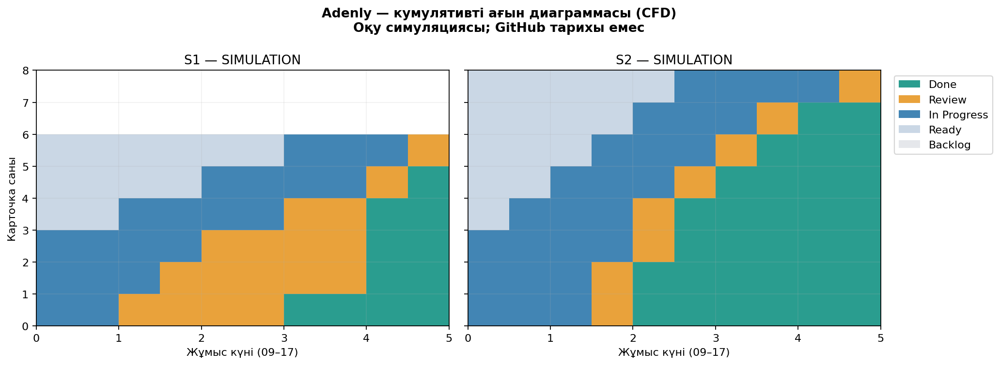
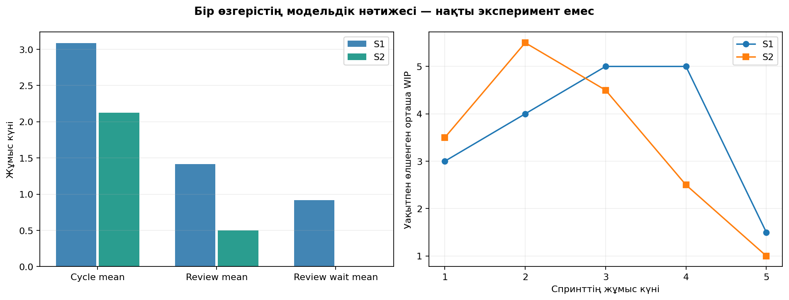

# Екі спринт метрикалары — SIMULATION

**Нақты GitHub тарихы емес.** Қолмен құрастырылған 14 карточка/84 оқиға сценарийі. Есеп нақты осы CSV файлдарынан қайта есептелді; орындалған өнім жұмысы немесе GitHub Projects export деп көрсетілмейді.

Бастапқы дерек: [карточка кестесі](data/simulated_board_export.csv), [timestamp журналы](data/simulated_transition_log.csv), [дерек сипаттамасы](data/simulation_metadata.json). Дайын нәтижелер: [task metrics](data/task_metrics.csv), [daily WIP](data/daily_wip.csv), [CFD snapshots](data/cfd_snapshots.csv), [JSON](data/metrics.json).

## 1. Бірдей әдіспен салыстыру

| Метрика | S1 | S2 | Өзгеріс |
|---|---:|---:|---:|
| Throughput, Done/спринт | 6.0000 | 8.0000 | +33.33% |
| Throughput / жұмыс күні | 1.2000 | 1.6000 | +33.33% |
| Орташа cycle time, күн | 3.0833 | 2.1250 | -31.08% |
| p85 cycle, күн | 4.0000 | 2.4750 | -38.12% |
| Орташа WIP, карточка | 3.7000 | 3.4000 | -8.11% |
| Бір task In Progress, орташа күн | 1.6667 | 1.6250 | -2.50% |
| Бір task Review, орташа күн | 1.4167 | 0.5000 | -64.71% |
| Review кезегінде күту, орташа күн | 0.9167 | 0.0000 | -100.00% |
| Нақты review басталғаннан Done-ға, орташа күн | 0.5000 | 0.5000 | -0.00% |
| Ready-де күту, орташа күн | 1.0000 | 0.9375 | -6.25% |
| Review peak, карточка | 3.0000 | 2.0000 | -33.33% |
| Иесіз review барда жаңа start саны | 3.0000 | 0.0000 | -100.00% |

## 2. Әр тапсырманың циклі және мәртебе уақыты

| ID | Спринт | Ready | In Progress | Review | Соның ішінде queue wait | Cycle |
|---|---|---:|---:|---:|---:|---:|
| SIM-01 | S1 | 0.000 | 1.000 | 3.000 | 2.500 | 4.000 |
| SIM-02 | S1 | 0.000 | 1.500 | 1.500 | 1.000 | 3.000 |
| SIM-03 | S1 | 0.000 | 2.000 | 2.000 | 1.500 | 4.000 |
| SIM-04 | S1 | 1.000 | 2.000 | 1.000 | 0.500 | 3.000 |
| SIM-05 | S1 | 2.000 | 2.000 | 0.500 | 0.000 | 2.500 |
| SIM-06 | S1 | 3.000 | 1.500 | 0.500 | 0.000 | 2.000 |
| SIM-07 | S2 | 0.000 | 1.500 | 0.500 | 0.000 | 2.000 |
| SIM-08 | S2 | 0.000 | 1.500 | 0.500 | 0.000 | 2.000 |
| SIM-09 | S2 | 0.000 | 2.000 | 0.500 | 0.000 | 2.500 |
| SIM-10 | S2 | 0.500 | 1.500 | 0.500 | 0.000 | 2.000 |
| SIM-11 | S2 | 1.000 | 1.500 | 0.500 | 0.000 | 2.000 |
| SIM-12 | S2 | 1.500 | 1.500 | 0.500 | 0.000 | 2.000 |
| SIM-13 | S2 | 2.000 | 1.500 | 0.500 | 0.000 | 2.000 |
| SIM-14 | S2 | 2.500 | 2.000 | 0.500 | 0.000 | 2.500 |

Барлық мәндер жұмыс күнінде. Cycle In Progress-ке алғашқы кіруден Done-ға дейін, Review күтумен бірге. Ready cycle-ға кірмейді; Backlog спринт басталғанға дейін қалады, Done терминал күйінің duration-ы циклге кірмейді. Review waiting — Review ұзақтығының ішкі бөлігі, оны Review-ге қайта қосып есептемейміз.

p85 — PERCENTILE.INC/инклюзивті сызықтық интерполяция: сұрыпталған массивтегі индекс (n−1)×0,85. S2 нақты массиві **[2; 2; 2; 2; 2; 2; 2.5; 2.5]**; индекс 5,95, нәтиже 2,475. n=6 және n=8 шағын үлгі, процентиль тұрақты болжам емес.

## 3. Орташа WIP және Литтл заңы

| Жұмыс күні | S1 WIP (уақытпен өлшенген) | S2 WIP (уақытпен өлшенген) |
|---|---:|---:|
| 1 | 3.00 | 3.50 |
| 2 | 4.00 | 5.50 |
| 3 | 5.00 | 4.50 |
| 4 | 5.00 | 2.50 |
| 5 | 1.50 | 1.00 |

WIP = In Progress + Review; blocked болса өзі тұрған күйде саналады. Әр күн үшін оқиғалар арасындағы occupancy×ұзақтық интегралданады; содан кейін 5 күннің орташа мәні алынады. Тек кешкі snapshot-тардың орташа санын алсақ күн ішінде тез аяқталған жұмыс жоғалып кетеді.

S1: WIP=3.7000; λ=6/5=1,2; mean cycle=18,5/6=3,083333; λ×CT=3,7000. Айырма 0. S2: WIP=3.4000; λ=8/5=1,6; mean cycle=17/8=2,125; λ×CT=3,4000. Сандық floating айырма шамамен 4,44×10⁻¹⁶, практикалық 0.

Бұл жерде басталған және аяқталған cohort бірдей, ашылу/жабылу WIP=0, сондықтан sample-path теңдігі дәл шығады. Бұл «шынайы команда стационар ағынға жетті» деген дәлел емес. Нақты қысқа спринтте carryover, rework, толық емес тапсырмалар, өлшем терезесі және percentile/орташа cohort сәйкессіздігі Литтл жуықтауын өзгертеді. Сәйкеспеу тек жоғалған датаны білдірмейді; алдымен уақыт бірлігі, шекара және cohort тексеріледі.

## 4. CFD бойынша тар орын

S1-де Review жолағы 0-ден 3 карточкаға дейін өсіп, шамамен 2–4 flow day аралығында қалың қалады. Иесіз review peak=3, орташа Review occupancy=1,7; бір task review queue wait=0,9167 күн. Тар орын — reviewer-дің міндетті түрде баяулығы емес, дайын жұмысты review-ге уақтылы алмау. S2-де Review peak=2, occupancy=0,8, иесіз review=0.

S1/S2 диаграммалары әр спринттің жергілікті 0–5 күн осімен жеке салынды: task саны 6 және 8, спринт reset-ін бір 10 күндік CFD-дегі «жұмыс жоғалуы» ретінде көрсетпейміз. Полосаның ұзындығы емес, тік қалыңдығы белгілі күйдегі карточка санын береді. График source-ы cfd_snapshots.csv, SVG нұсқасы charts/ ішінде.

## 5. Ненің өзгергені және дәлелдің шегі

Жалғыз R1 әрекеті Review кезегін pull тәртібімен өңдейді. Review processing elapsed екі спринтте де 0,5 күн; күту 0,9167 → 0. Сондықтан Review ұзақтығының қысқаруы кезектің жойылуынан. Cycle қысқаруының шамамен 95,65%-ы осы queue айырмасына, 4,35%-ы модельдегі In Progress айырмасына келеді. «Адамдар тезірек код жаза бастады» деген қорытынды жоқ.

Throughput 6→8 (+33,33%), cycle mean −31,08%, p85 −38,125%, WIP −8,11%. Ағын көлемі артқанда In Progress орташа occupancy 2,0→2,6 өсуі мүмкін; бұл өздігінен нашарлау емес, әр адамға 2 лимиті сақталған. Review peak 3→2, бір адамға In Progress peak 1→2: екі жағдайда да WIP саясаты бұзылмаған.

**Шектеу:** бұл деректер әдейі құрастырылған, мақұлданған оқу симуляциясы; тек бір процесс ережесі өзгертілгенімен task құрамы/күндері де модельдік. Сондықтан causal effect дәлелденбейді. Нақты командаға көшіру үшін екі апта timestamp журналын, review/CI/staging/DoD дәлелін жинап қайта салыстыру қажет.
