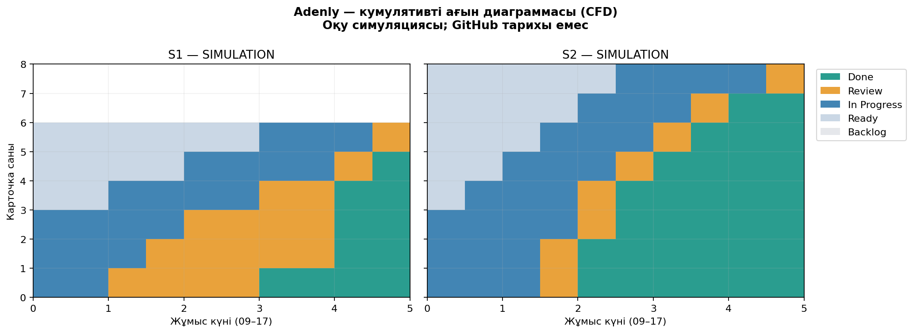

# Adenly — ЛЗ 9. Екі спринт симуляциясы

**Қазақша · 30.10.2026 · Пайдаланушы таңдаған ОҚУ СИМУЛЯЦИЯСЫ**

Команда: Жайрбек Арнұр — Project Manager; Байғұл Шыңғыс — Business / System Analyst; Есеркенов Абдулазиз — Technical Lead / Developer; Әшімбай Қайсар — Data / QA Analyst. Оқытушы: Некесова А.А.

Бұл пакет нақты екі апталық орындалған жұмысты көрсетпейді. Шартты спринттер: **02–06.11.2026** және **09–13.11.2026**. SIM-карточкалар мен оқиғалар қолмен жасалған; source issue-лар тек жобамен байланыстырады, нақты issue-лар жабылған жоқ.

## Тақта және жұмыс ережелері

- [Бағандардың entry/exit саясаты, WIP, DoR және DoD](01_Board_policies.md).
- [Екі модельдік тақта көрінісі](00_Board_snapshot.md) — GitHub-та бірден оқуға болады.
- [Екі спринттің пайдаланушылық мақсаттары мен жоспарлары](02_Sprint_plans.md).
- [GitHub Projects орнату және экспорт нұсқаулығы](05_GitHub_Projects.md).

**Live Projects шектеуі:** GitHub GraphQL/REST сұрауы `Forbidden` қайтарды. Live тақта/view осы ортадан жасалған не өзгертілген жоқ; WIP/DoD саясатымен бірге орнату скрипті берілді. GitHub-та репозиторийді оқу/жазу мүмкіндігі Projects API рұқсатын білдірмейді. UI қадамдары және қолжетімділік керек екені нұсқаулықта ашық көрсетілген.

## Метрика, CFD және жалғыз әрекет

| Метрика | S1 | S2 |
|---|---:|---:|
| Throughput, Done/спринт | 6 | 8 |
| Mean cycle, жұмыс күні | 3,0833 | 2,1250 |
| p85 cycle, жұмыс күні | 4,0000 | 2,4750 |
| Уақытпен өлшенген орташа WIP | 3,7000 | 3,4000 |
| Review кезегін күту, орташа күн | 0,9167 | 0,0000 |
| Review-дің өзін орындау, орташа күн | 0,5000 | 0,5000 |

**Жалғыз R1 әрекеті — Review-first:** жаңа task бастамас бұрын бос маман өзі авторы емес ең ескі иесіз review-ді алады. Иесі — **Әшімбай Қайсар**, енгізу мерзімі — **09.11.2026 09:00**, негізгі метрика — S2 mean review queue wait **≤0,5 жұмыс күні**. Бұл — симуляциялық шешім; нақты жиналыс/команда бекітуі ойдан қосылмайды.

[Толық метрикалар және түсіндіру](03_Metrics_report.md) · [30 минуттық ретроспектива хаттамасы](04_Retrospective.md) · [Қорғау мәтіні](06_Defense.md)



## Бастапқы деректер

- [Модельдік карточкалар CSV](data/simulated_board_export.csv) — **нақты GitHub export емес**.
- [Модельдік transition журнал CSV](data/simulated_transition_log.csv) — 14 карточка, 84 оқиға.
- [Әр task цикл/статус/күту уақыты](data/task_metrics.csv), [күндік WIP](data/daily_wip.csv), [CFD snapshots](data/cfd_snapshots.csv), [S1/S2 салыстыру](data/sprint_comparison.csv).
- [JSON есеп және source SHA-256](data/metrics.json), [дерек жорамалдары](data/simulation_metadata.json), [тексеру нәтижесі](data/validation.json).
- [Нақты жұмыс үшін бос timestamp журналы](data/real_transition_log_TEMPLATE.csv).

Литтл: S1 `6/5 × 3,083333 = 3,7`; S2 `8/5 × 2,125 = 3,4`. Ағын шекарасы In Progress + Review; ашылу/жабылу WIP=0. Жабық cohort-тарда теңдік күтіледі; бұл стационар production ағынның дәлелі емес. Нақты carryover/rework бар деректерге шекара түзетуі қажет.

## Жүктеп алу

| Файл | GitHub-та ашу | Тікелей жүктеу |
|---|---|---|
| Толық пакет | [ZIP](Adenly_LZ9_Paket.zip) | [ZIP жүктеу](https://github.com/Arnurzhairbek/Adenly/raw/refs/heads/main/docs/lz9/Adenly_LZ9_Paket.zip) |
| Қазақша есеп | [Word](Adenly_LZ9_Esep.docx) | [DOCX жүктеу](https://github.com/Arnurzhairbek/Adenly/raw/refs/heads/main/docs/lz9/Adenly_LZ9_Esep.docx) |
| Басып шығаруға | [PDF](Adenly_LZ9_Esep.pdf) | [PDF жүктеу](https://github.com/Arnurzhairbek/Adenly/raw/refs/heads/main/docs/lz9/Adenly_LZ9_Esep.pdf) |
| Формулалы метрикалар | [Excel / Calc](Adenly_LZ9_Metrics.xlsx) | [XLSX жүктеу](https://github.com/Arnurzhairbek/Adenly/raw/refs/heads/main/docs/lz9/Adenly_LZ9_Metrics.xlsx) |

## Қайта есептеу

Репозиторий түбірінен, Python 3.12 және requirements.txt тәуелділіктерімен:

```bash
python -m venv /tmp/adenly-lz9-venv
/tmp/adenly-lz9-venv/bin/pip install -r docs/lz9/requirements.txt
/tmp/adenly-lz9-venv/bin/python docs/lz9/scripts/analyze.py
/tmp/adenly-lz9-venv/bin/python docs/lz9/scripts/test_metrics.py
/tmp/adenly-lz9-venv/bin/python docs/lz9/scripts/build_report.py
```

CSV — бастапқы дерек. Оны күнделікті журналмен ауыстыру керек болса, симуляцияның нақты даталарын/жабық cohort шектеуін алдымен адаптациялаңыз. `create_simulation.py` тек әдейі симуляцияны қайта жасау үшін; ол CSV-ді қайта жазады, нақты журналды үстінен бастырмаңыз. Оны әдепкі қайта есептеу тізбегіне қоспадық.

Calc-та TaskMetrics NETWORKDAYS/MOD формулалары уақытты 8 сағаттық flow day-ге аударады; Summary-де COUNTIFS, AVERAGEIF, PERCENTILE және Литтл формулалары сақталған. DailyWIP event integral-ы Python арқылы есептелген. Жұмыс терезесі Mon–Fri 09–17, +05:00, мерекелер шегерілмеген. Формула/кэштер тексерілген, бірақ LibreOffice GUI-де файл ашу бұл ортада орындалмады.

[ЛЗ 8 пакеті](../lz8/README.md) · [Жобаның негізгі README](../../README.md)
