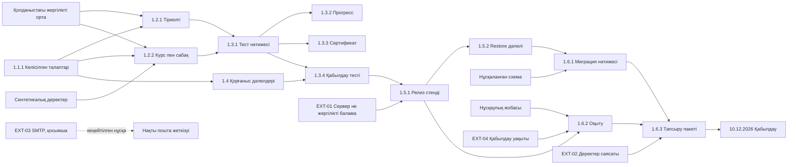

# ЛЗ 5 — тәуелділіктер картасы

Мәртебе: жоспар жобасы. Көрсеткі `A → B` — B нәтижесі A алғышартын қажет етеді; әр көрсеткі finish-to-start емес, кейбірі іске кірісуге қажетті қолжетімділік шарты.

1.5.1 соңғы релиз стенді I3-те аяқталады, бірақ ерте API/QA үшін қолданыстағы жергілікті орта пайдаланылады. Осылайша соңғы стенд пен ерте тест арасында цикл жоқ. Сыртқы SMTP минималды жабық демоны бөгемейді, алайда нақты пошта жеткізуін қабылдауды бөгейді.

## Сыртқы тәуелділіктер

Кестедегі күн — **растау жоспарланған күн**, растау фактісі емес. Бәрінің қазіргі күйі: расталмаған. ІТ/құқықтық байланыс тұлғаларының аты берілмеген; олар ойдан тағайындалмады. «Иесі» — команда ішіндегі нақты бақылаушы.

| ID | Не қажет | Кімнен | Жеке иесі | Растау мерзімі | Нені бөгейді | Сәтсіз болса балама |
|---|---|---|---|---|---|---|
| EXT-01 | Жабық стенд, сақтау орны, оператор және рұқсат | Университет ІТ-қызметі; нақты маман әлі анықталмаған | Есеркенов Абдулазиз | 23.10.2026 | 1.5.1 орналастыру; сыртқы ортадағы демо | Бар Docker ортасында синтетикалық жергілікті демо; production дайын деп көрсетпеу |
| EXT-02 | Университеттің деректер ережесі және дерек қолдану талаптары | Некесова А.А. арқылы тиісті университет бөлімі; ресми құқықтық мәтін | Байғұл Шыңғыс | 30.10.2026 | Нақты деректер пилоты және тиісті қабылдау құжаттары | Тек синтетикалық деректер, сыртқы ЖИ өшірулі; расталмаған сәйкестікті бекітпеу |
| EXT-03 | SMTP сынақ жәшігі және нақты жеткізу мүмкіндігі | Пошта провайдері / университет поштасының әкімшісі | Есеркенов Абдулазиз | 06.11.2026 | Кеңейтілген 1.2.1 нақты email қабылдауы | Бар test-only mail stub арқылы жабық демо; сыртқы жеткізу критерийі ашық |
| EXT-04 | Оқыту/қабылдау уақыты және қатысушылар | Некесова А.А., команда, болашақ оператор | Жайрбек Арнұр | 27.11.2026 | 1.6.2 оқыту және 1.6.3 қабылдау | 10.12-ге дейін басқа уақытты келісу; видео дәлел тек бағалаушы қабылдаса балама |

## Күнтізбе

[Тәуелділіктер күнтізбесі](dependencies-lz5.ics) төрт растау оқиғасын, 10.12 тапсыру оқиғасын және әрқайсысына **үш күн бұрын** DISPLAY ескертуін қамтиды. Бұл — импорттауға дайын `.ics` файл; Google/Outlook күнтізбесіне әлі енгізілген жоқ, хабарламалар шығады деп расталмайды. Күндер күндік оқиға ретінде берілген; импорттан кейін жергілікті уақыт пен хабарлама рұқсатын тексеру қажет.
