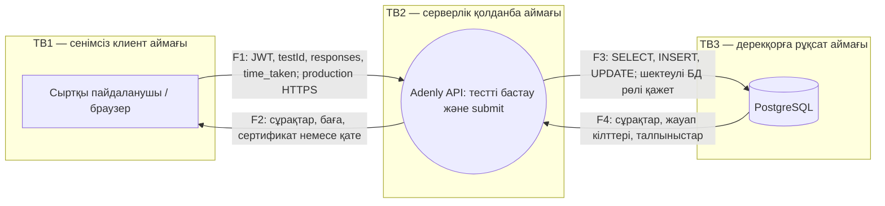

# ЛЗ 7 — STRIDE қауіптер моделі

Күні: 16.10.2026. Ауқым: Adenly тестілеу API компоненті. Мәртебе: код бойынша дайындалған модель; Threat Dragon браузеріне әлі енгізілмеген. Төмендегі граф — импортталған Threat Dragon жобасы емес.

## Деректер ағыны және сенім шекаралары

HTTPS пен шектеулі БД рөлі — мақсатты бақылаулар: олардың production-да орнатылғаны расталмады. docker-compose әдепкі postgres рөлімен жұмыс істейді. Клиенттен келген user_id, рөл, сұрақ/жауап ID және уақыт сенімді дерек ретінде қаралмайды.

## STRIDE

| ID | Санат | Нысан / ағын | Қауіп | Қазіргі бақылау / дәлел | Азайту шарасы | Шара күйі | Иесі, ұсыныс |
|---|---|---|---|---|---|---|---|
| T-S | Spoofing — тұлғаны жалған көрсету | F1, TB1→TB2 | Ұрланған localStorage JWT арқылы өзге пайдаланушы болып кіру | authMiddleware қолтаңбаны, мерзімді және purpose=access мәнін тексереді; AuthContext localStorage қолданады | XSS-тен қорғанысты тексеру, қауіпсіз cookie мүмкіндігін бағалау, токенді қайтарып алу | Ішінара; JWT тексеруі бар, қалғаны жоспарланған | Қайсар |
| T-T | Tampering — деректерді бұрмалау | F1, F3 | Басқа тесттің question_id/answer_id мәнін жіберіп бағаны бұрмалау | routes/tests.js submit сұрақты id бойынша алады; барлық байланыс пен толық жауаптар жиыны тексерілмейді | SEC-01: барлық сұрақтың test_id сәйкестігі, answer_id байланысы, қайталанулар, толық жиын, транзакция | Ашық | Абдулазиз |
| T-R | Repudiation — әрекеттен бас тарту | F1, F3 | Пайдаланушы сертификатқа әкелген нақты сұрауды жоққа шығарады | logger және test_attempts бар; өзгертілмейтін толық аудит дәлелі жоқ | Actor, request_id, action, object, outcome, timestamp аудиті; логты бөлек қорғау және сақтау мерзімі | Жоспарланған | Абдулазиз |
| T-I | Information disclosure — ақпараттың ашылуы | F2, F4 | Бөгде талпыныс немесе дұрыс жауаптар рұқсатсыз ашылады | attempts/:attemptId user_id бойынша сүзеді; start жауабында is_correct берілмейді | Иелікке арналған теріс тесттер; қате жауаптардан ішкі err.message алып тастау; минималды БД рөлі | Ішінара; толық теріс тесттер жоқ | Абдулазиз |
| T-D | Denial of service — қызмет көрсетуден бас тарту | F1, API, БД пулы | Үлкен responses массиві не параллель submit БД пулын толтырады | express.json 10mb және жалпы rate limiter бар; бизнес-жиым көлемі шектелмеген | Сұрақтар санына сай массив лимиті, timeout, concurrency шегі, submit rate limit, жүктеме тесті | Жоспарланған; жалпы шектеулер бар | Абдулазиз |
| T-E | Elevation of privilege — құқықты көтеру | F1 және әкімшілік маршрут | Ескі admin JWT рөл өзгергеннен кейін де admin құқықтарын сақтайды | adminMiddleware req.user.role мәніне сенеді; JWT-де role бар | Ағымдағы рөлді БД-дан тексеру немесе token version/revocation; рөл өзгерту теріс тесті | Ашық | Абдулазиз |

R02/R15 ↔ T-T, R03 ↔ T-S, R14 ↔ T-E. SEC-02 тест API ауқымынан тыс uploads компонентіндегі жеке DoS тәуекелін жабады. SEC-03 осы модельден кеңірек ЖИ мен дербес деректер шекарасын қарастырады.

## Threat Dragon-да аяқтау

1. OWASP Threat Dragon ресми қолданбасында жаңа модель ашу; әдіс ретінде STRIDE таңдау.
2. Бір сыртқы entity — User; бір process — Adenly Test API; бір datastore — PostgreSQL қосу.
3. TB1, TB2, TB3 шекараларын және F1–F4 ағындарын жоғарыдағыдай салу.
4. T-S–T-E жазбаларын тиісті элементке тіркеу; қауіп, шара, иесі және күйін кестеден көшіру. Шараларды Mitigated деп белгілемеу: жоспарланған іс орындалған емес.
5. Жобаны JSON ретінде экспорттап `docs/security/threat-dragon.json` файлына сақтау; қайта ашып алты қауіп пен шекараларды тексеру.

Браузерлік құрал бұл сессияда қолжетімсіз болғандықтан, осы бес қадамның орындалғаны туралы дәлел жоқ. Сілтеме: https://www.threatdragon.com/ ; ресми жоба: https://owasp.org/www-project-threat-dragon/ .
